<picture>
  <source media="(prefers-color-scheme: dark)" srcset="assets/banner-dark.svg">
  
</picture>

Student, learning web development.

### Projects

**[fishhawk-benches](https://github.com/courage-w/fishhawk-benches)**: a guide to public benches,
with the view from each seat, panoramas, a map, and sunrise/sunset times.
Next.js, TypeScript, Tailwind CSS.

